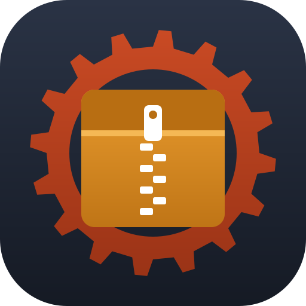
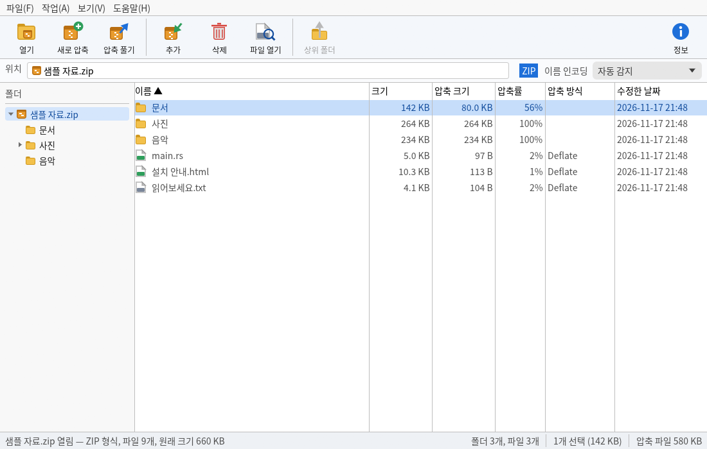
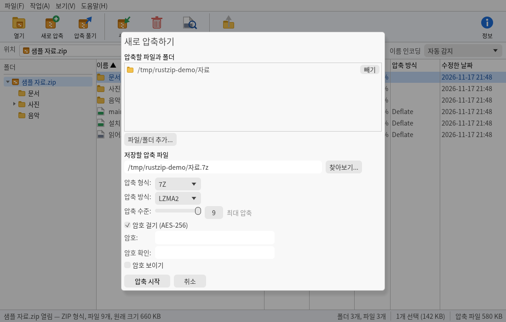
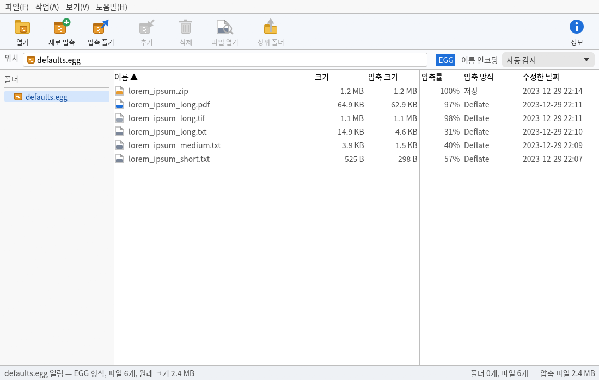
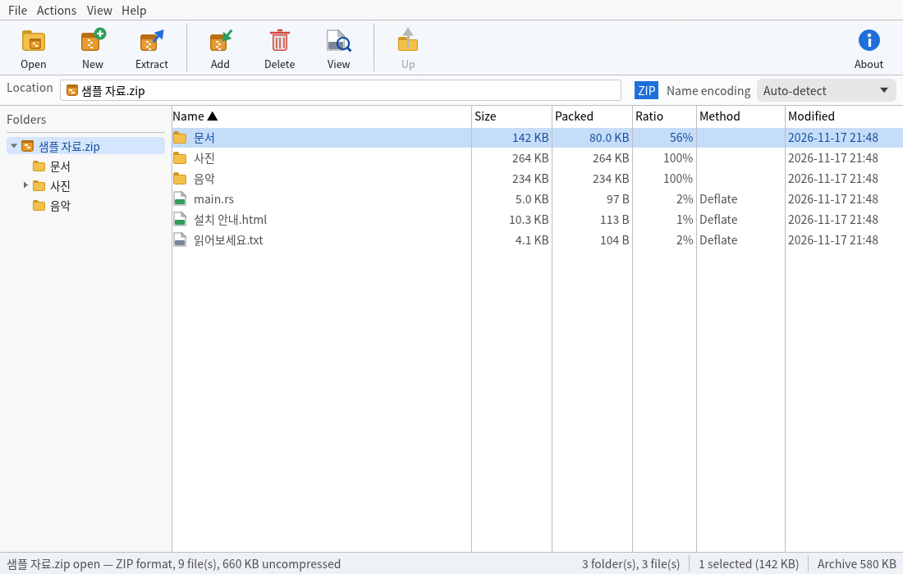

<p align="center">
  
</p>

<h1 align="center">RustZip</h1>

<p align="center">
  <b>Rust로 만든 가볍고 빠른 크로스플랫폼 압축 프로그램</b><br>
  ZIP · 7Z · RAR · ALZ · EGG를 비롯한 30가지가 넘는 형식을 한 창에서
</p>

<p align="center">
  
  
  
  
  
</p>

<p align="center">
  <a href="#주요-기능">주요 기능</a> ·
  <a href="#지원-형식">지원 형식</a> ·
  <a href="#설치">설치</a> ·
  <a href="#사용법">사용법</a> ·
  <a href="#개발">개발</a> ·
  <a href="UNSUPPORTED.md">제한 사항</a>
</p>

<p align="center">
  
</p>

---

## 주요 기능

- **🗜️ 거의 모든 압축 파일 열기** — ZIP, 7Z, RAR부터 국내에서 많이 쓰는 ALZ·EGG(AZO 압축 포함), 옛 형식인 LZH·ARJ, 디스크 이미지 ISO까지 엽니다.
- **📦 원하는 형식으로 만들기** — ZIP과 7Z는 압축 방식을 고를 수 있고, TAR와 단일 파일 압축은 9가지 알고리즘을 지원합니다.
- **🔐 AES-256 암호** — ZIP과 7Z에 암호를 걸 수 있고, 7Z는 파일 목록까지 숨깁니다. 풀 때는 ZipCrypto, AES, LEA, RAR 암호를 지원합니다.
- **🇰🇷 한글 파일 이름 자동 인식** — Windows에서 만든 CP949/EUC-KR 이름을 알아서 읽습니다. 직접 고를 수도 있습니다.
- **🧭 익숙한 화면** — 폴더 트리, 열 정렬, 압축률과 압축 방식 표시, 끌어다 놓기, 진행 표시와 취소를 지원합니다.
- **🛡️ 안전한 압축 풀기** — `..`나 드라이브 문자로 폴더 밖에 쓰려는 항목을 건너뛰고, 모든 항목의 CRC를 확인합니다.
- **🪶 실행 파일 하나** — 설치 과정이나 함께 배포할 파일이 없습니다.

<table>
  <tr>
    <td></td>
    <td></td>
  </tr>
  <tr>
    <td align="center">새로 압축하기 — 형식·방식·수준·암호 선택</td>
    <td align="center">EGG 파일 — 항목마다 압축 방식 표시</td>
  </tr>
</table>

## 지원 형식

| 형식 | 열기·풀기 | 만들기 | 비고 |
|---|:---:|:---:|---|
| **ZIP** (JAR 등) | ✅ | ✅ | Deflate, Deflate64, BZip2, LZMA, XZ, Zstandard, PPMd, Shrink/Reduce/Implode · AES-256, ZipCrypto · 파일 추가·삭제 |
| **7Z** | ✅ | ✅ | LZMA, LZMA2, PPMd, BZip2, Deflate, Zstandard, Brotli, LZ4, BCJ 필터 · AES-256 |
| **RAR** | ✅ | — | RAR 1.5~7, 솔리드, 분할(`.partN.rar`), 암호, 파일 목록 암호 |
| **EGG** | ✅ | — | 저장, Deflate, BZip2, LZMA, AZO · ZipCrypto, AES-128/256, LEA-128/256 · 솔리드, 분할 |
| **ALZ** | ✅ | — | 저장, Deflate, ALZ BZip2 · ZipCrypto · 분할(`.a00`) |
| **LZH / LHA** | ✅ | — | lh0~lh7, lhx, lz4/lz5/lzs, pm0~pm2 |
| **ARJ** | ✅ | — | 방식 0~4 |
| **CAB** | ✅ | — | 저장, MSZIP, LZX |
| **ISO** | ✅ | — | ISO 9660, Joliet(유니코드 이름) |
| **TAR** | ✅ | ✅ | 아래 겉포장 압축과 조합: `.tar.gz`, `.tgz`, `.tar.zst` … |
| **CPIO** | ✅ | — | newc, crc, odc, bin |
| **AR** (`.a`, `.deb`) | ✅ | — | GNU·BSD 긴 이름 |
| **GZ · BZ2 · XZ · LZMA · LZ · ZST · LZ4 · BR · SZ** | ✅ | ✅ | 단일 파일 또는 TAR/CPIO/AR 겉포장 |
| **Z** (compress) | ✅ | — | LZW |
| **자동 압축 풀기 .exe** | ✅ | — | 안에 든 ZIP·RAR |

형식은 확장자가 아니라 **파일 내용**으로 판별합니다. 그래서 확장자가 틀린 파일도 열립니다.
지원하지 않는 것과 제한 사항은 [UNSUPPORTED.md](UNSUPPORTED.md)에 모아 두었습니다.

## 설치

빌드된 실행 파일을 따로 배포하지 않으므로 소스에서 빌드합니다. **Rust 1.95 이상**과 **C/C++ 컴파일러**가 필요합니다. RAR(UnRAR)와 Zstandard는 C/C++ 소스를 함께 빌드하기 때문입니다.

```sh
# https://rustup.rs 에서 rustup 설치 후
rustc --version          # 1.95.0 이상인지 확인 (낮으면 rustup update)

git clone https://github.com/sk8er123/rustzip.git
cd rustzip
cargo build --release
./target/release/rustzip
```

빌드 결과는 `target/release/` 아래에 실행 파일 하나로 나옵니다.

<details>
<summary><b>🪟 Windows</b></summary>

1. **Visual Studio Build Tools**를 설치하고 **"C++를 사용한 데스크톱 개발"**을 선택합니다(MSVC 링커, C/C++ 컴파일러, Windows SDK).
   <https://visualstudio.microsoft.com/visual-cpp-build-tools/>
2. rustup으로 Rust를 설치합니다(기본값 `x86_64-pc-windows-msvc`).
3. PowerShell에서 빌드하고 실행합니다.

   ```powershell
   cargo build --release
   .\target\release\rustzip.exe
   ```

- 릴리스 빌드는 콘솔 창 없이 GUI만 뜹니다. 디버그 빌드(`cargo build`)는 콘솔 창이 함께 떠서 오류 출력을 볼 수 있습니다.
- 한글 글꼴은 Windows 기본 글꼴인 맑은 고딕(`malgun.ttf`)을 씁니다.
- ARM64용: `rustup target add aarch64-pc-windows-msvc` 후 `cargo build --release --target aarch64-pc-windows-msvc`

</details>

<details>
<summary><b>🍎 macOS</b></summary>

1. Xcode 명령줄 도구를 설치합니다: `xcode-select --install`
2. rustup으로 Rust를 설치합니다.
3. `cargo build --release` 후 `./target/release/rustzip`

- 한글 글꼴은 macOS 기본 글꼴인 Apple SD Gothic Neo를 씁니다.
- 결과물은 `.app` 번들이 아니라 실행 파일입니다.
- Apple Silicon과 Intel에서 모두 도는 유니버설 바이너리:

  ```sh
  rustup target add aarch64-apple-darwin x86_64-apple-darwin
  cargo build --release --target aarch64-apple-darwin
  cargo build --release --target x86_64-apple-darwin
  lipo -create -output rustzip \
      target/aarch64-apple-darwin/release/rustzip \
      target/x86_64-apple-darwin/release/rustzip
  ```

</details>

<details>
<summary><b>🐧 Linux</b></summary>

1. C/C++ 컴파일러를 설치합니다. 그 밖의 `-dev` 패키지는 필요 없습니다. 창, 그래픽, 글꼴 라이브러리는 실행할 때 불러옵니다.

   | 배포판 | 명령 |
   |---|---|
   | Ubuntu / Debian | `sudo apt install build-essential` |
   | Fedora | `sudo dnf install gcc gcc-c++` |
   | Arch | `sudo pacman -S base-devel` |

2. rustup으로 Rust를 설치합니다.
3. `cargo build --release` 후 `./target/release/rustzip`

- 실행하려면 X11 또는 Wayland 데스크톱과 OpenGL/Vulkan 드라이버가 필요합니다.
- 한글이 네모로 보이면 한글 글꼴을 설치하세요: `fonts-noto-cjk`(Debian/Ubuntu), `google-noto-sans-cjk-fonts`(Fedora), `noto-fonts-cjk`(Arch)
- 터미널을 닫아도 창을 유지하려면: `nohup ./target/release/rustzip >/dev/null 2>&1 &`

</details>

## 사용법

```sh
rustzip                      # 빈 창으로 시작
rustzip 자료.egg              # 압축 파일을 열면서 시작
rustzip --lang en            # 이번 실행만 영어로 (ko | en)
```

| 단축키 | 동작 | 단축키 | 동작 |
|---|---|---|---|
| `Ctrl+O` | 열기 | `Del` | 삭제 (ZIP) |
| `Ctrl+N` | 새로 압축 | `Backspace` | 상위 폴더 |
| `Ctrl+E` | 압축 풀기 | `Enter` | 열기 |
| `Ctrl+A` | 모두 선택 | | |

- **끌어다 놓기**: 압축 파일 하나를 놓으면 열고, 다른 파일을 놓으면 새로 압축하거나 열어 둔 ZIP에 추가합니다.
- **시작 언어**: `--lang` 옵션, 보기 › 언어 메뉴에서 마지막으로 고른 언어, OS 언어 순서로 정합니다(한국어가 아니면 영어).
- **언어 설정이 저장되는 곳**: Windows `%APPDATA%\RustZip\settings.txt`, macOS `~/Library/Application Support/RustZip/settings.txt`, Linux `~/.config/rustzip/settings.txt`

<p align="center">
  
</p>

## 개발

### 테스트

```sh
cargo test --release                              # 전체 테스트
cargo test --release -- --ignored big_file        # 200MB 파일 테스트(느림)
./target/release/rustzip --self-test 결과.json    # 실제 창으로 압축 → 폴더 이동 → 풀기 점검
./target/release/rustzip --screenshot 화면.png    # 예제 압축 파일을 열어 화면을 PNG로 저장
```

- **만들 수 있는 모든 형식·방식** — 만들고 다시 열어 풀었을 때 원본과 바이트까지 같은지 비교합니다.
- **다른 프로그램이 만든 실제 파일** — `tests/fixtures/`의 RAR, ARJ, LZH, EGG, ALZ 샘플을 풉니다. EGG·ALZ는 크기, CRC, SHA-256까지 확인합니다.
- **시스템 도구와의 호환성** — `zip`, `unzip`, `tar`, `gzip`, `bzip2`, `xz`, `zstd`, `cpio`, `ar`, `xorriso`, `uncompress`, `python3`를 씁니다(Unix만 해당). 도구가 없으면 그 테스트는 건너뛰고, 이유는 `cargo test -- --nocapture`로 볼 수 있습니다.

### 소스 구조

| 경로 | 내용 |
|---|---|
| `src/main.rs` | 시작, 명령줄 옵션, 글꼴 설정 |
| `src/app.rs` | 프로그램 상태, 백그라운드 작업 |
| `src/views.rs` · `src/dialogs.rs` · `src/picker.rs` | 메인 화면, 대화 상자, 내장 파일 선택 창 |
| `src/engine.rs` | 형식 판별(압축 구조 × 겉포장 압축), 목록, 풀기, ZIP 만들기·수정 |
| `src/engine/filter.rs` | 겉포장 압축 GZ, BZ2, XZ, LZMA, LZ, ZST, LZ4, BR, SZ, Z |
| `src/engine/walk.rs` | 항목을 차례로 읽는 형식들의 공통 틀 |
| `src/engine/formats/` | 형식별 읽기: RAR, ALZ, EGG, LZH, ARJ, CAB, ISO, TAR, CPIO, AR |
| `src/engine/codec/` | ALZ BZip2, AZO, ZipCrypto, LEA, AES 해독 |
| `src/engine/create.rs` | 7Z, TAR, 단일 파일 만들기 |
| `src/i18n.rs` · `src/icons.rs` | 한국어/영어 문자열, 코드로 그린 아이콘 |
| `examples/logo.rs` | 로고 생성기 |

동작 규칙은 [MECHANICS.md](MECHANICS.md)에 정리되어 있습니다.

### 로고

로고는 이미지 편집기가 아니라 Rust 코드로 그립니다. `examples/logo.rs`가 같은 도형 목록으로 SVG와 PNG를 함께 만듭니다.

```sh
cargo run --release --example logo    # assets/logo.svg, logo.png(512px), logo-128.png
```

## 감사의 말

RustZip은 다음 프로젝트 위에서 만들어졌습니다.

- [egui / eframe](https://github.com/emilk/egui) — GUI
- [zip](https://crates.io/crates/zip), [sevenz-rust2](https://crates.io/crates/sevenz-rust2), [tar](https://crates.io/crates/tar) — ZIP, 7Z, TAR
- [unrar](https://crates.io/crates/unrar) (RARLAB UnRAR) — RAR
- [delharc](https://crates.io/crates/delharc), [unarj-rs](https://crates.io/crates/unarj-rs), [cab](https://crates.io/crates/cab) — LZH, ARJ, CAB
- [flate2](https://crates.io/crates/flate2), [bzip2](https://crates.io/crates/bzip2), [lzma-rust2](https://crates.io/crates/lzma-rust2), [zstd](https://crates.io/crates/zstd), [lz4_flex](https://crates.io/crates/lz4_flex), [brotli](https://crates.io/crates/brotli), [snap](https://crates.io/crates/snap) — 압축 알고리즘
- [EggDotNet](https://github.com/akolman/EggDotNet) — EGG 형식, AZO 해독기, LEA 구현의 참고 자료와 테스트 샘플
- [unalz](https://github.com/kippler/unalz) — ALZ 형식 참고 자료
- [lhasa](https://github.com/fragglet/lhasa) — LZH 테스트 샘플

## 라이선스

이 프로젝트의 라이선스는 아직 정하지 않았습니다.
함께 쓰는 구성 요소는 각자의 라이선스를 따릅니다. 특히 RAR 해제에 쓰는 **UnRAR 소스는 RAR 압축기를 만드는 데 쓸 수 없다**는 조건이 있습니다.
